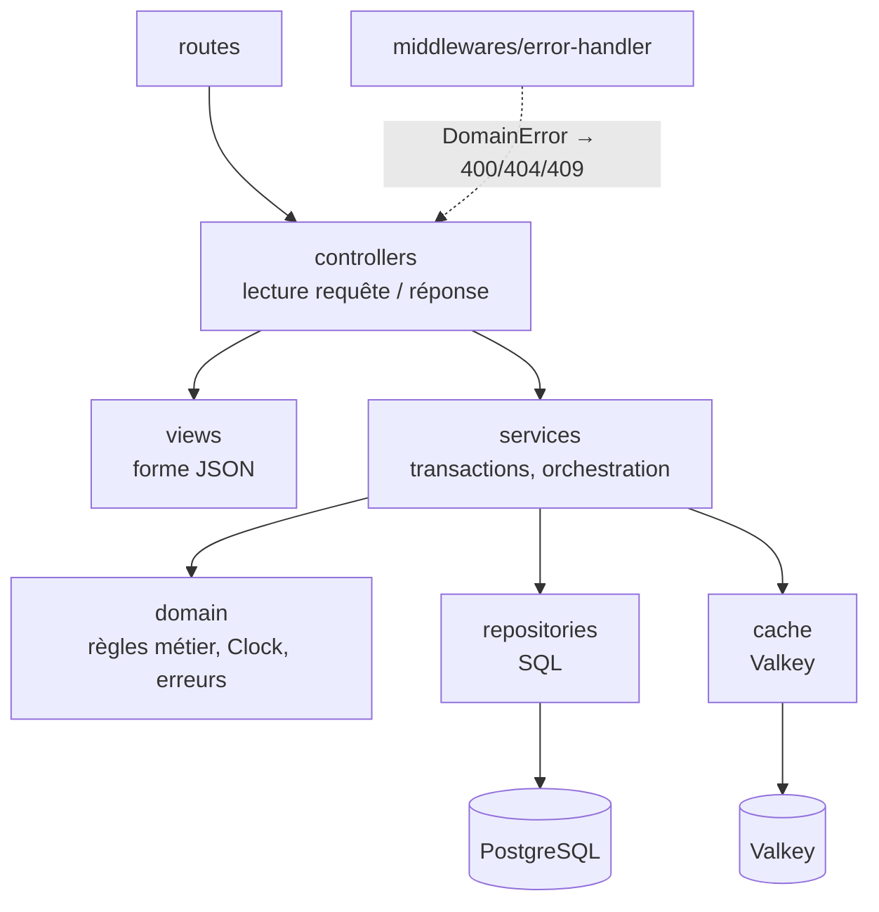
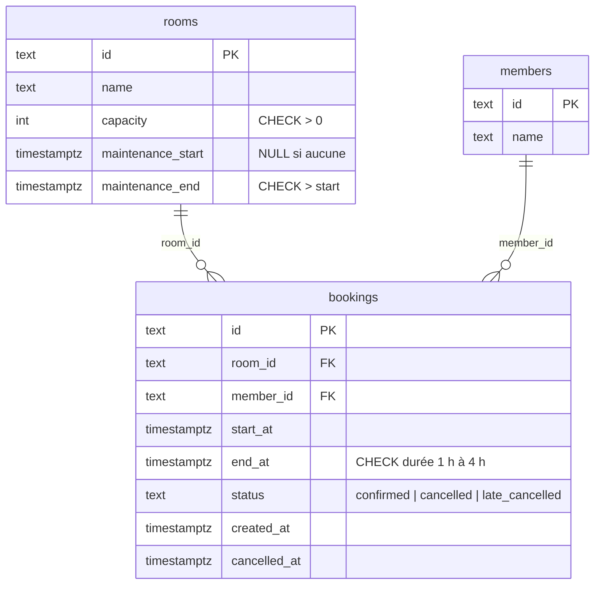

# DECISIONS — Studio Riff

## 1. Où vit chaque règle métier

| Règle | Implémentation | Pourquoi | Réponse HTTP |
|---|---|---|---|
| Un créneau dure de 1 h à 4 h, commence à une heure pleine, entre 10 h et 23 h (UTC) | Domaine : `assertValidSlot` dans `src/domain/booking.ts`. En base, un `CHECK` sur la durée sert de filet. | Règle pure qui ne dépend que des deux dates : testable sans base ni HTTP. Interprétation retenue : le créneau tient entièrement dans la plage 10 h – 23 h du même jour (dernier départ possible à 22 h pour 1 h). Une réservation ne peut pas commencer dans le passé (l'horloge est passée en paramètre). | 400 |
| Deux réservations d'une même salle ne se chevauchent jamais, même en concurrence | Domaine : `assertNoOverlap` (intervalles semi-ouverts `[start, end)`). Base : contrainte `EXCLUDE USING gist (room_id WITH =, tstzrange(start_at, end_at, '[)') WITH &&) WHERE (status = 'confirmed')`. | Le domaine donne un message clair dans le cas courant. Seule la base voit les transactions concurrentes : deux requêtes simultanées passent toutes deux la vérification applicative, la contrainte d'exclusion rejette la seconde (code `23P01`, converti en 409). La borne `[)` autorise un créneau qui commence à l'heure exacte où le précédent finit. Les réservations annulées sont exclues de la contrainte. | 409 |
| Un membre a au plus 2 réservations à venir | Domaine : `assertMemberLimit` (« à venir » = `confirmed` et début postérieur à l'horloge). Service : la vérification s'exécute dans une transaction qui verrouille la ligne du membre (`SELECT … FROM members WHERE id = $1 FOR UPDATE`). | La règle porte sur **plusieurs lignes** : aucune contrainte `CHECK`/`UNIQUE` ne peut l'exprimer, et une contrainte qui dépend de l'heure courante n'a pas de sens en base. Le domaine garde la règle ; le verrou sur le membre sérialise les créations d'un même membre pour que deux requêtes parallèles ne voient pas toutes les deux « 1 réservation » (voir ADR 2). | 409 |
| Une annulation reste enregistrée : `cancelled`, ou `late_cancelled` à moins de 24 h du début ; pas deux annulations | Domaine : `cancelBooking(booking, clock)`. Service : `SELECT … FOR UPDATE` sur la réservation. Base : `CHECK` sur les valeurs de `status`. | Règle qui dépend de l'heure : elle reçoit l'horloge. Le verrou évite que deux `DELETE` simultanés passent tous les deux. Une réservation déjà commencée ne peut plus être annulée. | 204 / 409 |
| Une salle en maintenance refuse toute réservation qui empiète sur la maintenance | Domaine : `assertRoomAvailable(room, start, end)` dans `src/domain/room.ts`. Base : colonnes `maintenance_start` / `maintenance_end` sur `rooms`. | Même logique de chevauchement `[start, end)` que pour les réservations, données portées par la salle. | 409 |
| Toutes les heures en UTC | Colonnes `timestamptz`, sérialisation ISO 8601 avec `Z` dans la vue. | — | — |

Autres choix de contrat : un `memberId` inconnu renvoie 404 ; un corps JSON invalide ou des dates illisibles renvoient 400 ; le planning ne liste que les réservations `confirmed`.

## 2. Schéma des couches

Les dépendances vont uniquement vers le bas. `domain` n'importe rien : ni Express, ni `pg`, ni Valkey. Les contrôleurs ne contiennent aucune règle, ils traduisent HTTP ↔ service. `app.ts` assemble les couches et reçoit l'horloge, le pool et le cache par injection.

## 3. Modèle relationnel

Contrainte `bookings_no_overlap` : `EXCLUDE USING gist (room_id WITH =, tstzrange(start_at, end_at, '[)') WITH &&) WHERE (status = 'confirmed')`, qui nécessite `btree_gist`.

## 4. ADR

### ADR 1 — `pg` et SQL écrit à la main plutôt qu'un ORM

- **Contexte.** Le cœur du sujet repose sur des fonctionnalités propres à PostgreSQL : `tstzrange`, contrainte d'exclusion GiST, `SELECT … FOR UPDATE`, code d'erreur `23P01`, `EXPLAIN ANALYZE` sur une requête précise.
- **Décision.** Driver `pg` (node-postgres), requêtes paramétrées écrites à la main et regroupées dans `src/repositories`. Migrations en fichiers `.sql` numérotés, appliquées par un petit script qui tient une table `schema_migrations`.
- **Alternatives écartées.** Prisma et TypeORM ne savent pas déclarer une contrainte `EXCLUDE` dans leur schéma (il faut de toute façon du SQL brut) et masquent la requête réellement exécutée, ce qui gêne la mesure de l'étape 5. Un query builder (Knex) apporterait peu sur 3 tables.
- **Conséquences.** Le SQL est visible et mesurable, et le schéma est exactement celui qu'on lit dans la migration. En contrepartie, le passage ligne → objet du domaine est écrit à la main (une fonction `toBooking` par repository).

### ADR 2 — Limite de 2 réservations : règle dans le domaine, sérialisée par un verrou sur le membre

- **Contexte.** La règle concerne l'ensemble des réservations d'un membre et dépend de l'heure. Deux `POST` simultanés du même membre peuvent tous deux compter 1 réservation à venir et en créer une 3ᵉ.
- **Décision.** Le service ouvre une transaction, verrouille la ligne du membre (`FOR UPDATE`), charge ses réservations confirmées et appelle `assertMemberLimit` du domaine avec l'horloge. Le second `POST` attend la fin du premier puis voit 2 réservations, et reçoit un 409.
- **Alternatives écartées.** Un *trigger* PostgreSQL déplacerait la règle hors du domaine et l'éloignerait de l'horloge injectée (il appellerait `now()`), donc il ne serait pas testable avec une horloge fixe. Le niveau `SERIALIZABLE` fonctionnerait mais imposerait de rejouer les transactions en cas d'erreur de sérialisation (`40001`), ce qui est plus complexe pour un gain nul à l'échelle de l'association. Un verrou distribué dans Valkey ajouterait une dépendance critique à une base qui doit pouvoir tomber.
- **Conséquences.** Les créations d'un même membre sont sérialisées, ce qui est sans impact à l'échelle de Studio Riff (3 membres, 4 salles). Les créations de membres différents restent parallèles ; le chevauchement entre elles est garanti par la contrainte d'exclusion.
